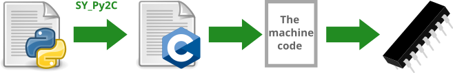

# Транслятор из Python в C ([english version](README.md))

Используйте синтаксис Python, чтобы писать чистый C-код для ваших микроконтроллеров:



## Примеры

Транслируйте Python в C:

```python
from py2c.shortcuts import trans_c

print(trans_c('''
def hello(a: int, b: int = 5) -> 'const char*':
    return 'positive' if a + b > 0 else 'negative or zero'

def main() -> int:
    print(hello(-10))
    return 0
'''))
```

Выведет на экран:
```c
 #include "stdio.h"

const char* hello(int a, int b) {
    return (a + b > 0) ? "positive" : "negative or zero";
}
const char* hello(int a) {
    return hello(a, 5);
}
int main(void) {
    printf(hello(-10));
    return 0;
}
```

Без короткой функции у вас больше контроля:

```python
from py2c.bytecode_walker import translate
from py2c.translator_cpp import TranslatorC

my_python_code = '''
def hello(a: int, b: int = 5) -> 'const char*':
    return 'positive' if a + b > 0 else 'negative or zero'

def main() -> int:
    print(hello(-10))
    return 0
'''

with open('c_code.c') as c_file:
    translator = TranslatorC(save_to=c_file)
    translate(translator, my_python_code)
```

Транслируем Python в C и вызываем полученный C-код из Python:

```python
from py2c.shortcuts import inline_c


def someFunctionCalledFromTheCppFunction(var: int, var2: int) -> int:
    return var + var2


def somePurePythonFunction(var: int, var2: int) -> int:
    return var * var2


@inline_c
def someFunctionThatGetsCompiledAndCachedAtExecutionTime(var: int, var2: int) -> int:
    return someFunctionCalledFromTheCppFunction(var, var2)


theAnswerToTheUniverse: int = someFunctionThatGetsCompiledAndCachedAtExecutionTime(30, 2) + somePurePythonFunction(5, 2)
print(f"theAnswerToTheUniverse: {theAnswerToTheUniverse}")
```

Выведет: `theAnswerToTheUniverse: 42`

## Демо

Транслируйте, компилируйте и выполните за один раз:
```bash
python3 demo.py 1> demo.c && g++ demo.c && g++ demo.c && ./a.out
```

Запустите Python-кода вместе с C-кодом:
```bash
python3 demo_inline_c.py
```

## Установка/Удаление

Используйте эту команду для установки Py2C:
```bash
pip install git+https://github.com/syeysk/sy_py2c.git
apt install python3.11-dev
```

Укажите Вашу версию Python вместо `python3.11`.

Используйте эту команду для удаления Py2C:
```bash
pip uninstall py2c
```


## Описание функций и классов

`py2c.shortcuts.trans_c(source_code, write_to=None)` - транслирует python-код в c-код. Аргументы:
- `source_code` - исходный python-код в виде unicode-строки (типа `str`) или объект текстового файла (возвращаемый функцией `open`)
- `write_to` - файловый объект, в который будет записан результирующий c-код. Если `write_to` равен `None` (по умолчанию), то функция вернёт c-код как строку (типа `str`)

`py2c.TranslatorC(save_to)` - класс транслятора python-to-c. Содержит некоторые методы для трансляции конструкций. Аргументы:
- `save_to` - файловый объект, в который будет записан результирующий c-код

`py2c.translate(translator, source_code: str)` - конвертирует `source_code` в AST, обходит его и строит c-код. Arguments:
- `translator` - экземпляр транслятора. Например, `py2c.TranslatorC` или `py2c.TranslatorCpp`
- `source_code` - исходный python-код (типа `str`)

## Примеры интерфейса командной строки

Вы можете использовать `py2c` или `python -m py2c` равнозначно.

Создаёт *your_source_code.c* с c-кодом:
```bash
py2c your_source_code.py
```

Создаёт *your_output_code.c* с c-кодом:
```bash
py2c your_source_code.py -o your_output_code.c
```

Выводит c-код в консоль:
```bash
py2c your_source_code.py -p
```


## Trash :-D

Поддерживаются следующие операции:
- присваивание переменным константных значений: целые положительные числа и строки.

Ограничения:
- типы всегда объявлять через аннотацию при инициализации.
- функция всегда возвращает только одно значение (в планах - сделать возврат массива для возврата нескольких значений)

- все целые положительные числа по умолчанию имеют c-тип "int"
- строки по умолчанию - тип "unsigned char"

## Дорожная карта

[Дорожная карта](ROADMAP.ru.md)

## Поддержка

Обсудить Py2C, получить помощь или сделать предложени:
- https://t.me/sy_py2c

Новости о других проектах:
- https://t.me/it_syeysk

## Links

- [Описание узлов Python](https://greentreesnakes.readthedocs.io/en/latest/nodes.html)
- [Стандарт C](http://www.open-std.org/jtc1/sc22/wg14/)
